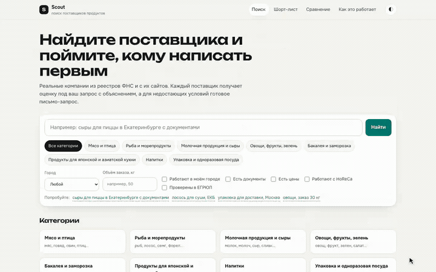

# Scout: поиск поставщиков для ресторанов

Прототип для второй части тестового задания Goulash.tech. Поиск → объяснимая оценка → сравнение → письмо-запрос → шорт-лист с полученными условиями.

## Демо за 40 секунд

[](https://github.com/sviatoslav-a/food-suppliers/raw/refs/heads/main/docs/demo/scout-demo.mp4)

**[Смотреть полную запись MP4, 40 секунд](https://github.com/sviatoslav-a/food-suppliers/raw/refs/heads/main/docs/demo/scout-demo.mp4)** · [Статичное превью](docs/demo/scout-demo.jpg)

Настоящая запись приложения с данными 86 поставщиков. Письма не отправляются; заметки демо сохраняются только в одноразовом браузерном профиле.

**Первая часть задания:** [портфолио](https://sviatoslav-a.github.io/) · [исходники портфолио](https://github.com/sviatoslav-a/sviatoslav-a.github.io).

## Запуск за минуту

Нужны Python 3.12+ и [uv](https://docs.astral.sh/uv/).

```sh
uv sync --frozen
uv run uvicorn scout.web:app --host 127.0.0.1 --port 8000
```

Открыть http://127.0.0.1:8000. Готовая `data/suppliers.sqlite` включена в проект. Для работы приложения **не нужны LLM, ключи API, исходный реестр или повторный сбор данных**. Внешняя загрузка шрифтов необязательна: есть системные замены.

## Демо за 3 минуты

1. Ввести «сыры для пиццы в Екатеринбурге с документами». Видны распознанные параметры, поставщики, баллы и объяснения. Город повышает релевантность; отдельный фильтр ограничивает географию.
2. Выбрать 2–4 поставщика для сравнения. Оценить MOQ, доставку, цены и документы; ссылка на сравнение передаёт параметры запроса.
3. Открыть карточку: источники опубликованных условий, контакты, результат проверки ИНН, недостающие сведения.
4. Отредактировать письмо-запрос, скопировать или открыть в почтовом клиенте. Приложение **не отправляет письма**; статус «отправлен» устанавливается только вручную.
5. Добавить поставщика в шорт-лист, записать цену из КП, минимальный заказ и заметку, перенести в «Получено КП» / «Договор». Перезагрузка сохраняет данные. CSV шорт-листа включает статусы, заметки и ваши условия.
6. Открыть `/about`: методика, покрытие данных и ограничения. `/docs`: JSON API.

## Данные

Снимок собран 13.10.2026, реестр МСП от 10.09.2026:

| Поле | Поставщиков |
|---|---:|
| Всего после исключений и дедупликации | 86 |
| Телефон или ролевая почта | 85 |
| Телефон | 85 |
| Email | 58 |
| Цены на сайте | 34 |
| Минимальный заказ | 46 |
| Доставка | 72 |
| Упоминания документов | 46 |
| ИНН найден в ЕГРЮЛ | 38 |
| ИНН найден в реестре МСП | 22 |

8 категорий: мясо, рыба, молочные продукты, овощи, бакалея, азиатские продукты, напитки, упаковка. Два целевых города: Екатеринбург и Москва; федеральные поставщики тоже могут присутствовать. Категории пересекаются.

96 извлечённых сайтов → 86 поставщиков, 10 исключений. Отчёты: `data/build_report.json`, `data/quality_report.json`. Контакты `bubon-horeca.ru` не найдены; при повторном обходе сайт был недоступен. Недостающие цены и условия остаются пустыми, **синтетических поставщиков и цен нет**. Извлечение LLM может ошибаться: ссылки на источники не заменяют проверку закупщиком.

Документы — заявления на сайте, **не подтверждение действительности сертификатов**. Росаккредитация и Меркурий не интегрированы. ЕГРЮЛ проверяет найденный ИНН, а не право владения сайтом и не надёжность будущих поставок. Снимок не является live-поиском и не подтверждает текущие цены/наличие.

## Архитектура и выбор формата

- FastAPI + Jinja: серверный HTML, доступные по ссылке поиск и сравнение; основные страницы работают без JS.
- Vanilla JS: обновление результатов, сравнение, localStorage-шорт-лист, RFQ и CSV. Шорт-лист требует JS, хранится **только в текущем браузере**, без синхронизации и резервного копирования.
- SQLite + FTS5: компактный read-only снимок. `scout/service.py` — единая логика для веба, API и MCP.
- `scout/query.py`: детерминированный разбор русскоязычных запросов, не LLM-чат. Поддержка ограничена словарём категорий/городов и полнотекстовым поиском.
- Оценка 0–100: ассортимент 25, география 20, данные юрлица 20, коммерческие условия 15, HoReCa 10, упоминания документов 10; штрафы за MOQ и риски. Это объяснимая эвристика, не кредитный рейтинг.
- LLM используется **при сборе**, не на каждом запросе: поиск сайтов и извлечение коммерческих условий. Контакты извлекаются регулярными выражениями.

Веб подходит для сравнения колонок, возвращения к сохранённой работе и передачи ссылок. MCP позволяет подключить ту же базу к ERP-ассистенту без отдельной логики ранжирования.

## API и MCP

```sh
curl 'http://127.0.0.1:8000/api/search?category=dairy&city=ekb&limit=5'
curl 'http://127.0.0.1:8000/healthz'
uv run python -m scout.mcp_server
```

MCP работает по stdio: `search_suppliers`, `get_supplier`, `draft_request`; ресурс `scout://taxonomy`. Используется MCP SDK 2.x. Запускайте из корня проекта или передайте `uv --directory /absolute/path/to/food-suppliers run python -m scout.mcp_server` в конфигурации клиента.

## Проверки

```sh
uv run playwright install chromium
uv run pytest -q
uv run python -m pipeline.audit
```

42 проверки: ядро, все карточки и источники снимка, JSON/CSV, реальный MCP stdio, 7 Chromium E2E-сценариев. Покрытие и ограничения: [docs/verification.md](docs/verification.md). Скриншоты desktop/mobile создаются в `test-results/`.

## Повторная запись видео

При запущенном приложении на `http://127.0.0.1:8000`:

```sh
uv run python tools/record_demo.py
```

Нужны Chromium и `ffmpeg` / `ffprobe`. MP4 и постер сохраняются в `docs/demo/`. Запись не изменяет базу и не связывается с поставщиками.

## Повторный сбор (не нужен для демо)

Требует сети, авторизованного Claude CLI и доступной квоты. Извлечение при настроенном `LLM_PROVIDER=codex` может использовать Codex CLI; discovery с веб-поиском требует Claude. Пайплайн использует кеши. Оригинальные 2 ГБ реестра и кеши **не включаются в git**.

```sh
# Скачать ZIP реестра вручную с официальной страницы ФНС:
# https://www.nalog.gov.ru/opendata/7707329152-rsmp/
# сохранить как data/raw/rsmp.zip
uv run python -m pipeline.rsmp
uv run python -m pipeline.discover --workers 2
uv run python -m pipeline.fetch
uv run python -m pipeline.extract --workers 2
uv run python -m pipeline.contacts
uv run python -m pipeline.build
uv run python -m pipeline.audit
```

Сбор идёт по публичным страницам, с проверкой robots.txt и задержкой запросов. CAPTCHA не обходится. `build` сверяет ИНН с кешем/ЕГРЮЛ и атомарно заменяет снимок; **перезапустите приложение после пересборки**, потому что Store кеширует данные в памяти. Фильтр ролевой почты — мера минимизации, не юридическая гарантия: перед публикацией нужны проверка персональных данных и условий использования источников.

## Что нужно для production

Плановое обновление и срок актуальности каждого поля; ручная верификация личности поставщика и документов; серверная БД, авторизация и совместная работа; мониторинг качества извлечения; доступ к реестрам на разрешённых условиях; защита публичного сборщика от SSRF, сетевые лимиты и изоляция. Сейчас сборщик — локальный CLI, публичного endpoint для обхода произвольных URL нет.
